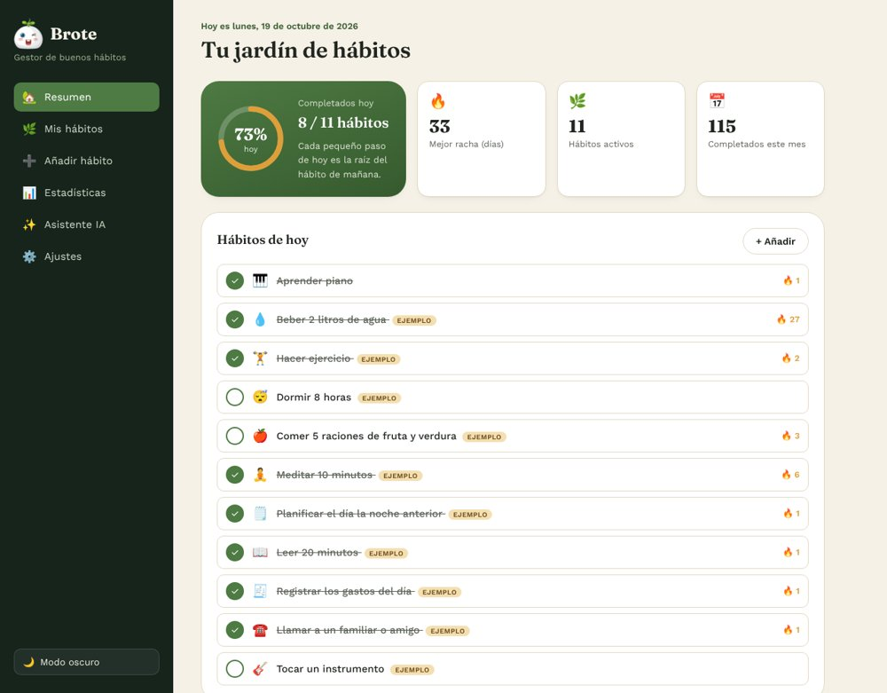
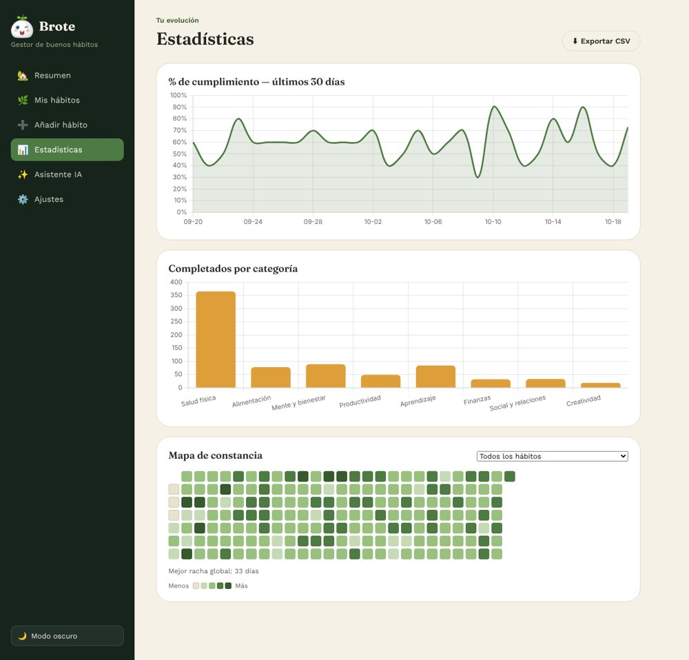
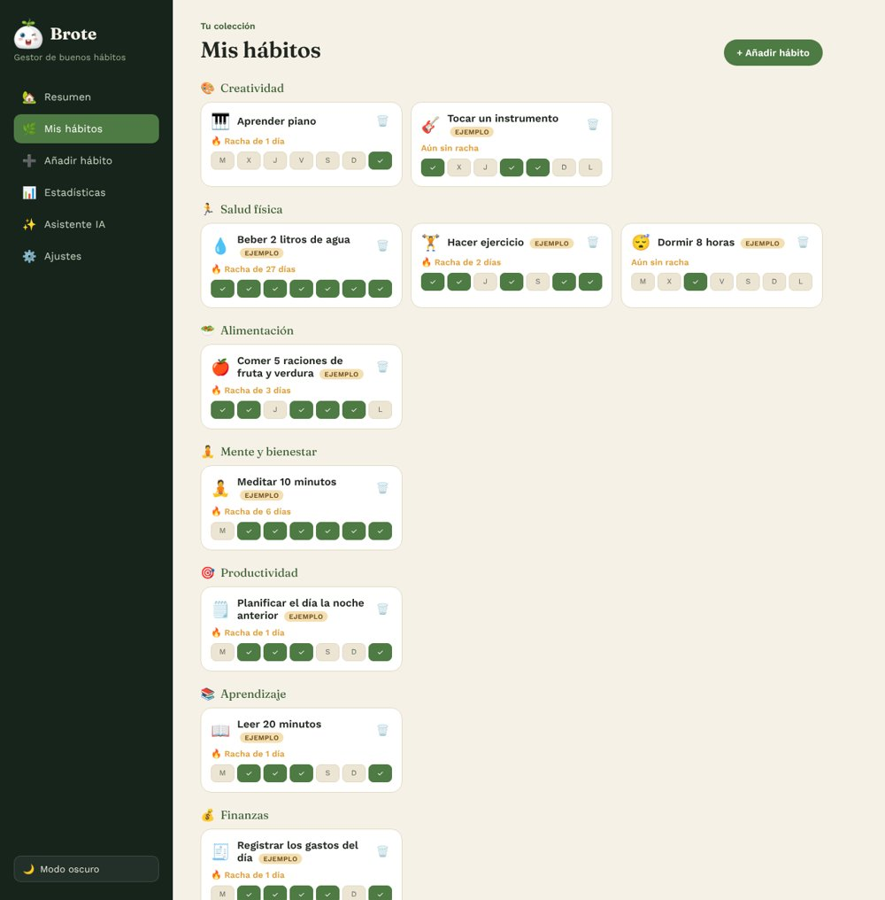
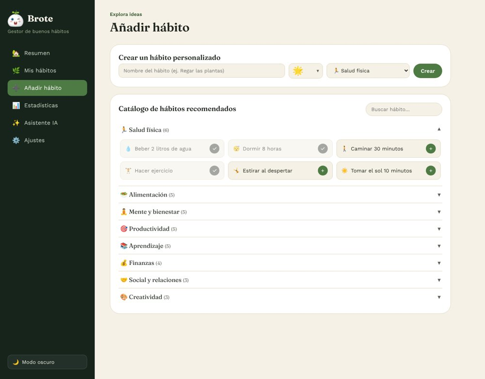
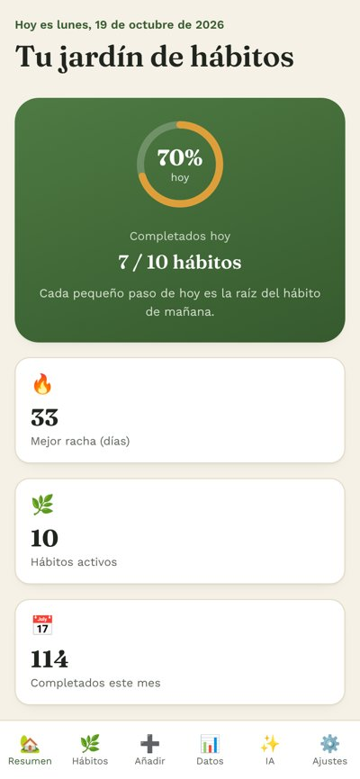

# 🌱 Brote — Gestor de buenos hábitos

Proyecto final del **Máster de Programación + IA** (Jobie TECH).

Brote es una aplicación web para crear, seguir y mantener buenos hábitos.
Incluye un catálogo amplio de hábitos precargados, seguimiento diario con
rachas, estadísticas visuales (gráficas y mapa de calor) y un asistente de
inteligencia artificial que analiza tu progreso y te da consejos, usando la
**API gratuita de Google Gemini**.

**100% gratuita**, tanto para desarrollarla como para usarla: no requiere
backend, base de datos de pago ni ninguna suscripción. Todo el código es
HTML, CSS y JavaScript "vanilla" (sin frameworks ni paso de compilación).

> **🔗 Demo online:** _pega aquí la URL de Vercel_ (por ejemplo `https://brote-habitos.vercel.app`)
> **📦 Repositorio:** _pega aquí la URL de GitHub_
> **🎬 Vídeo de presentación (2–3 min):** _pega aquí el enlace, si lo subes_

## 🖼️ Así se ve

| Resumen | Estadísticas |
|---|---|
|  |  |

| Mis hábitos | Añadir hábito | En el móvil |
|---|---|---|
|  |  |  |

## 🎯 Qué problema resuelve

Mantener buenos hábitos es fácil de decir y difícil de cumplir, porque casi
nunca vemos con claridad nuestro propio progreso. Brote ofrece un único sitio
sencillo donde apuntar los hábitos, una forma muy visual de ver la
constancia (rachas, gráficas, mapa de calor) y un asistente de IA que lee tus
datos reales y te da un consejo concreto. No es una lista de tareas: es un
seguimiento de comportamientos que se repiten día tras día.

---

## ✨ Funcionalidades

- **Seguimiento diario de hábitos**: marca cada hábito como hecho hoy (o en
  cualquiera de los últimos 7 días), con cálculo automático de racha actual
  y mejor racha.
- **Selector de emojis por categoría**: al crear un hábito personalizado se propone un emoji de la categoría elegida y se puede escoger entre muchas opciones, incluso de otras categorías (incluidos instrumentos musicales).
- **Catálogo precargado** de más de 30 hábitos organizados en 8 categorías
  (salud física, alimentación, mente y bienestar, productividad,
  aprendizaje, finanzas, social y creatividad), además de la posibilidad de
  crear hábitos 100% personalizados.
- **Panel de resumen (dashboard)** con anillo de progreso del día, rachas,
  lista de hábitos de hoy y un mini mapa de constancia.
- **Estadísticas**: gráfica de % de cumplimiento de los últimos 30 días,
  gráfica de completados por categoría y un mapa de calor de hasta 6 meses
  (general o por hábito individual).
- **Asistente de IA** (Google Gemini, capa gratuita): analiza tu progreso
  reciente y te da feedback + una recomendación concreta, o te sugiere un
  hábito nuevo que complemente los que ya tienes. También genera un
  "consejo del día" en el panel de resumen.
- **Datos de ejemplo**: en Ajustes se pueden cargar 10 hábitos con ~6 meses de historial inventado (marcados como «ejemplo») para ver gráficas, rachas y mapa de constancia con vida, y quitarlos después sin tocar los hábitos reales.
- **Empezar de cero**: quitar solo los datos de ejemplo, borrar solo el historial (conservando los hábitos) o borrar todo.
- **Exportar a CSV** todo tu historial de hábitos completados.
- **Copia de seguridad** de tus datos en un archivo JSON (exportar/importar).
- **Modo claro / oscuro**, diseño responsive (móvil, tablet y escritorio).
- **Persistencia local**: todos los datos se guardan en `localStorage`, en
  tu propio navegador. No se envían a ningún servidor propio.

## 🧱 Tecnologías

- HTML5, CSS3 (variables CSS, grid, flexbox) y JavaScript ES6 puro.
- [Chart.js](https://www.chartjs.org/) (vía CDN) para las gráficas.
- [Google Fonts](https://fonts.google.com/) (Fraunces + Work Sans).
- `localStorage` del navegador como base de datos.
- API REST gratuita de **Google Gemini** (`generativelanguage.googleapis.com`)
  para la funcionalidad de inteligencia artificial.

No hay build step: es un sitio estático puro, así que se puede abrir
directamente o publicar en cualquier hosting estático gratuito.

## 📂 Estructura del proyecto

```
brote-habitos/
├── index.html                 # estructura de la app (todas las vistas)
├── css/
│   └── style.css               # sistema de diseño y estilos
├── js/
│   ├── data.js                 # categorías y catálogo de hábitos precargados
│   ├── storage.js              # localStorage, rachas y estadísticas
│   ├── demo.js                 # datos de ejemplo (generación y borrado)
│   ├── ai.js                   # integración con la API de Gemini
│   ├── ui.js                   # funciones de renderizado del DOM
│   └── main.js                 # eventos, routing e inicialización
├── img/
│   ├── brote-icon.png          # mascota (icono de la barra lateral), fondo transparente
│   ├── brote-logo.png          # logo completo con fondo transparente
│   └── screens/                # capturas usadas en este README
├── docs/
│   ├── Documento_presentacion.pdf   # documento breve de presentación (1–2 págs.)
│   └── Manual_Brote_v2.pdf          # manual completo y visual (35 págs.)
├── DOCUMENTACION_DESARROLLO.txt # bitácora detallada del desarrollo
└── README.md
```

## ▶️ Probarla en local

No hace falta instalar nada. Basta con abrir `index.html` en el navegador,
o (recomendado, para que `localStorage` funcione sin restricciones) servirla
con cualquier servidor estático, por ejemplo:

```bash
# con Python
python3 -m http.server 8080

# o con Node (npx, gratis)
npx serve .
```

Y visitar `http://localhost:8080`.

## 🧪 Probarla con datos de ejemplo

¿Quieres ver la app «con vida» sin tener que usarla durante meses?
Ve a **Ajustes → Datos de ejemplo → Cargar datos de ejemplo**. Se añaden 10
hábitos con unos 6 meses de historial inventado (marcados con la etiqueta
*EJEMPLO*). Cuando quieras, **Quitar datos de ejemplo** los elimina sin tocar
tus hábitos reales. En la misma pantalla puedes borrar solo el historial o
todos los datos para empezar de cero.

## 🔑 Activar el asistente de IA (gratis)

1. Entra en [Google AI Studio](https://aistudio.google.com/apikey) con una
   cuenta de Google y genera una clave de API gratuita.
2. En la app, ve a **Ajustes → Inteligencia artificial**, pega tu clave y
   pulsa "Guardar clave" (puedes probar la conexión antes con "Probar
   conexión").
3. Ve a **Asistente IA** y pulsa "Analiza mi progreso" o "Sugiéreme un
   hábito nuevo".

El modelo utilizado es **`gemini-3.6-flash`** (el único disponible en el
selector de Ajustes, porque es el que se ha comprobado que funciona con la
capa gratuita).

**¿Qué se envía a Google?** Solo un resumen: nombres de los hábitos, su
categoría, rachas y el % medio de cumplimiento de los últimos 14 días. No se
envían fechas sueltas, ni nombre, ni correo.

La clave se guarda **solo en tu navegador** (`localStorage`) y las
peticiones van directamente desde tu navegador a los servidores de Google:
esta app no tiene backend propio ni almacena tu clave en ningún sitio.

## 🚀 Publicar gratis en Vercel

1. Sube esta carpeta a un repositorio público de GitHub.
2. Entra en [vercel.com](https://vercel.com), inicia sesión con GitHub y
   pulsa "Add New… → Project".
3. Selecciona el repositorio. Como es un sitio estático, no hace falta
   configurar ningún "build command": deja "Framework Preset" en
   **Other** y el "Output Directory" en la raíz (`.`).
4. Pulsa "Deploy". En un par de minutos tendrás una URL pública
   (`tu-proyecto.vercel.app`).

También funciona igual de bien en **GitHub Pages** o **Netlify**, sin
ningún cambio en el código.

## 🧠 Cómo se ha usado la IA

- **Dentro de la app:** tres usos reales de Gemini con datos del usuario
  (análisis de progreso, sugerencia de hábito nuevo y consejo del día).
- **Durante el desarrollo:** Claude ha actuado como copiloto (estructura
  inicial, catálogo de hábitos, revisión del diseño, pruebas automáticas). Las
  decisiones de enfoque y las restricciones del proyecto las ha tomado el autor.

## 🔭 Qué mejoraría con más tiempo

Sincronización opcional entre dispositivos (Supabase), frecuencias
configurables (p. ej. «3 veces por semana»), un chat libre con la IA,
recordatorios con la Notifications API y una librería de iconos SVG.

## 📄 Documentación completa

- [`docs/Documento_presentacion.pdf`](./docs/Documento_presentacion.pdf): versión breve.
- [`docs/Manual_Brote_v2.pdf`](./docs/Manual_Brote_v2.pdf): manual visual y detallado.

Todo el razonamiento del desarrollo —decisiones de diseño, arquitectura,
modelo de datos, cómo funciona cada pantalla y la integración de IA paso a
paso, cómo se probó la app y qué se mejoraría con más tiempo— está en
[`DOCUMENTACION_DESARROLLO.txt`](./DOCUMENTACION_DESARROLLO.txt).

## 📜 Licencia

MIT. Úsalo, modifícalo y compártelo libremente.
